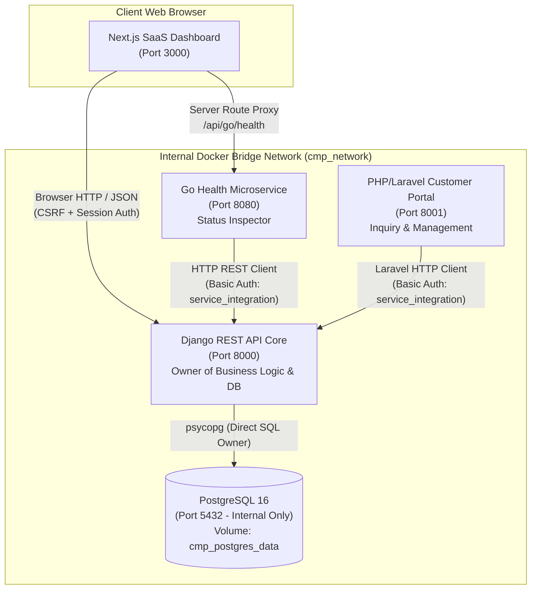

# Cloud Management Platform (CMP)

A clean, modular, and defensible Cloud Management Platform designed as a multi-service **Monorepo** for a technical Take-Home Assignment.

---

## 1. Architectural Overview

The project is structured to demonstrate clean separation of concerns, robust inter-service communication over HTTP REST APIs, and strict database ownership:

- **Frontend (`frontend/`)**: Modern SaaS dashboard built with **Next.js & TypeScript** (featuring responsive design, Dark/Light modes, Persian/English i18n, and RTL/LTR layout support).
- **Core Backend (`backend/`)**: Central business domain, REST APIs (`/api/v1/`), and **sole owner of the PostgreSQL database**, built with **Python & Django REST Framework**.
- **Primary Database**: **PostgreSQL** (developed locally on macOS, containerized via Docker Compose).
- **Independent Go Service (`go-service/`)**: Independent microservice in **Go** providing a runtime `/health` endpoint with `service_id` query support that inspects service status via Django REST APIs.
- **Additional Service (`php-service/`)**: Independent microservice built with **PHP & Laravel** performing customer lookups and service status updates using Laravel HTTP Client.
- **Documentation (`docs/`)**: Architecture blueprints, data design, API specs, security guides, and testing documentation.



> **Data Ownership Rule**: Django is the **sole and exclusive owner** of the PostgreSQL database schema and migrations. Independent services (`go-service` and `php-service`) NEVER connect directly to PostgreSQL; all cross-service operations occur over HTTP REST APIs.

---

## 2. Monorepo Repository Structure

```text
cloud-management-platform/
├── backend/                  # Core Backend (Django REST Framework + PostgreSQL)
├── frontend/                 # Frontend Dashboard (Next.js + TypeScript)
├── go-service/               # Independent Service (Go)
├── php-service/              # Additional Service (PHP + Laravel)
├── docs/                     # Comprehensive technical documentation
│   ├── ARCHITECTURE.md       # Architectural specifications & data flows
│   ├── DATABASE.md           # PostgreSQL schema & ER diagrams
│   ├── API.md                # REST API references & endpoints
│   ├── ENVIRONMENT.md        # Environment variables matrix
│   ├── SECURITY.md           # RBAC, CSRF, and container security
│   ├── TESTING.md            # Test suites & execution commands
│   ├── TROUBLESHOOTING.md    # Common issues & safe resolutions
│   └── RELEASE_NOTES.md      # v1.0.0 release notes
├── docker-compose.yml        # Multi-service container orchestration
├── CHANGELOG.md              # Project version history
└── README.md                 # Primary project documentation
```

---

## 3. Quickstart: Run with Docker Compose (Recommended)

### Prerequisites:
- Git
- Docker Desktop on macOS/Windows, or Docker Engine and Docker Compose plugin on Linux.

*Note: Separately installed PostgreSQL, Python, Node.js, Go, PHP, or Composer are **not required** when running via Docker Compose.*

### Step-by-Step Execution:

1. **Clone the repository and enter the directory:**
   ```bash
   git clone https://github.com/Reza-Msv/Cloud-Management-Platform.git
   cd Cloud-Management-Platform
   ```

2. **Inspect or copy environment templates:**
   The repository includes working `.env.example` templates for each service:
   ```bash
   cp .env.example .env
   cp backend/.env.example backend/.env
   cp frontend/.env.example frontend/.env
   cp go-service/.env.example go-service/.env
   cp php-service/.env.example php-service/.env
   ```

3. **Build and start all 5 services:**
   ```bash
   docker compose up -d --build
   ```

4. **Verify container health:**
   ```bash
   docker compose ps
   ```
   All five containers (`cmp_db`, `cmp_backend`, `cmp_frontend`, `cmp_go_service`, `cmp_php_service`) will report `Up (healthy)`.

5. **Access Application URLs:**
   - **Frontend SaaS Dashboard**: [http://localhost:3000](http://localhost:3000)
   - **Django API Documentation (Swagger)**: [http://localhost:8000/api/docs/](http://localhost:8000/api/docs/)
   - **Go Health Check & Inspector**: [http://localhost:8080/health?service_id=10](http://localhost:8080/health?service_id=10)
   - **PHP Customer Portal**: [http://localhost:8001/?customer_id=28](http://localhost:8001/?customer_id=28)

6. **Stop containers safely:**
   ```bash
   docker compose down
   ```
   *Named volume `cmp_postgres_data` is preserved automatically. Never run `docker compose down -v` unless you intentionally wish to delete all database records.*

---

## 4. Alternative: Run Services Locally Without Docker

### Prerequisites
- **PostgreSQL 16+** running locally on port `5432` (`cloud_management_db`, user: `cloud_management_user`).
- **Python 3.12+**
- **Node.js 22+** and **pnpm 10.24+**
- **Go 1.22+**
- **PHP 8.4+** and **Composer 2+**

### Terminal 1 — Django Backend
```bash
cd backend
python3 -m venv .venv && source .venv/bin/activate
pip install -r requirements/base.txt
python manage.py migrate
python manage.py runserver localhost:8000
```

### Terminal 2 — Next.js Frontend
```bash
cd frontend
pnpm install
pnpm dev
```

### Terminal 3 — Go Microservice
```bash
cd go-service
go run ./cmd/server
```

### Terminal 4 — PHP Service (Laravel)
```bash
cd php-service
composer install
php artisan key:generate
php artisan serve --host=127.0.0.1 --port=8001
```

---

## 5. Evaluator Testing & Demo Credentials

For evaluators reviewing this project, preset demo accounts are provisioned in the persistent Docker database:

| Role | Username | Password (Dev Only) | Permissions / Scope |
| :--- | :--- | :--- | :--- |
| **Admin** | `admin_user` | `SecretPassword123!` | Superuser & Django Admin access. Full CRUD on Customers and Services. |
| **Operator** | `operator_user` | `SecretPassword123!` | Restricted Operator role. Read customers, read services, create services, update service status. **No Django admin or user management**. |
| **Service Integration** | `service_integration` | *(Configured in `.env`)* | Dedicated non-superuser service account used exclusively by Go & PHP microservices. |

---

## 6. Automated Testing Commands

```bash
# Backend test suite (122 tests)
docker compose exec backend python manage.py test

# Go microservice test suite (17 tests)
cd go-service && go test -v ./... && go vet ./...

# PHP / Laravel test suite (11 tests, 27 assertions)
cd php-service && php artisan test

# Next.js frontend test suites (Vitest unit tests & Playwright E2E)
cd frontend && pnpm test && pnpm test:e2e
```

---

## 7. Documentation Index

- [docs/ARCHITECTURE.md](docs/ARCHITECTURE.md): System architecture, service boundaries, and inter-service HTTP communication contracts.
- [docs/DATABASE.md](docs/DATABASE.md): Customer 1 ---- N Service data model, schema specification, and Django database ownership.
- [docs/API.md](docs/API.md): Full REST API references, status codes, and request/response payloads.
- [docs/ENVIRONMENT.md](docs/ENVIRONMENT.md): Comprehensive environment variable matrix and safe placeholders.
- [docs/SECURITY.md](docs/SECURITY.md): RBAC matrix, CSRF, CORS, session cookie security, and container hardening.
- [docs/TESTING.md](docs/TESTING.md): Test suites breakdown, frameworks, and verification commands.
- [docs/TROUBLESHOOTING.md](docs/TROUBLESHOOTING.md): Common runtime diagnoses and safe remedies.
- [docs/RELEASE_NOTES.md](docs/RELEASE_NOTES.md): v1.0.0 release notes and feature overview.
