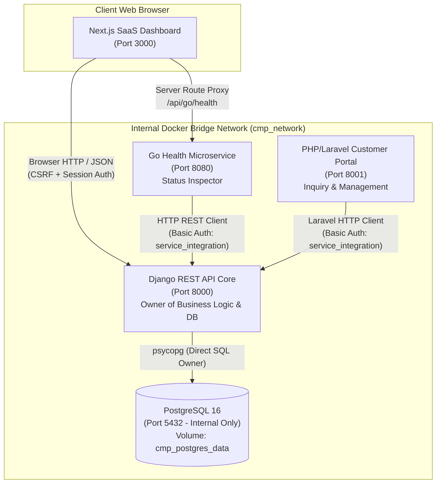
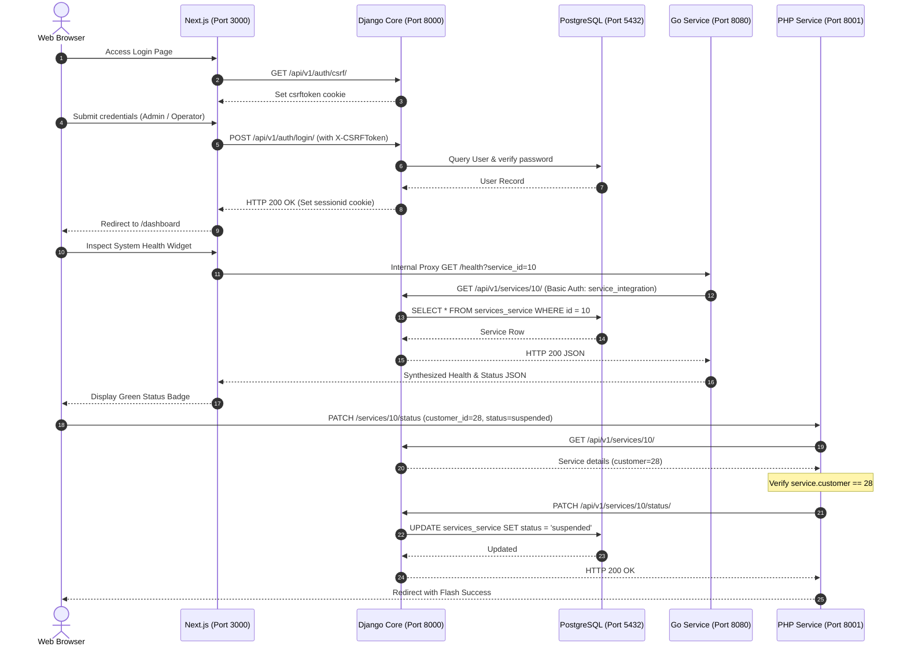

# System Architecture & Technical Specifications

This document outlines the architectural blueprints, system boundaries, inter-service communication protocols, and design trade-offs of the Cloud Management Platform (CMP).

---

## 1. High-Level Architecture Overview

The Cloud Management Platform is architected as a **modular multi-service monorepo**. It enforces a strict separation of concerns, defensive inter-service communication over HTTP REST APIs, and centralized data ownership:

---

## 2. Core Service Boundaries & Responsibilities

### 2.1 Django Core Backend (`backend/`)
- **Technology**: Python 3.12+, Django 5.x, Django REST Framework (DRF), Gunicorn.
- **Role**: Central authority and **sole owner of PostgreSQL**.
- **Responsibilities**:
  - Domain business logic, entity validation, and data persistence.
  - Role-Based Access Control (RBAC) via `Admin` and `Operator` groups.
  - Session and CSRF authentication for browser clients.
  - HTTP Basic Authentication for auxiliary microservices.
  - OpenAPI 3 / Swagger documentation generation via `drf-spectacular`.

### 2.2 Next.js Frontend Dashboard (`frontend/`)
- **Technology**: Next.js 16 (App Router), React 19, TypeScript, Tailwind CSS, TanStack Query, Zustand, Lucide Icons.
- **Role**: Primary administrative and operator web interface.
- **Responsibilities**:
  - Responsive SaaS layout with desktop, tablet, and mobile views.
  - Internationalization (`next-intl`) with English (`/en`) and Persian (`/fa`) supporting dynamic bidirectional layout switching (LTR / RTL).
  - Client-side caching and deduplicated data fetching.
  - Dark, light, and system theme switching via CSS variables.
  - Secure internal proxy route handler (`/api/go/health`) querying the Go microservice behind container boundaries.

### 2.3 Independent Go Microservice (`go-service/`)
- **Technology**: Go 1.22+, Standard Library (`net/http`), Alpine container.
- **Role**: Lightweight health-check and cloud service status inspector.
- **Responsibilities**:
  - High-performance, zero-dependency health reporting (`GET /health`).
  - Service status inspection (`GET /health?service_id={id}`) communicating upstream with Django REST APIs via a resilient client with timeout protection.
  - Never connects directly to PostgreSQL.

### 2.4 Additional PHP/Laravel Service (`php-service/`)
- **Technology**: PHP 8.4+, Laravel 11+, Blade Templates.
- **Role**: Independent customer inquiry and service lifecycle portal.
- **Responsibilities**:
  - Customer lookup and associated service status modification.
  - Strict ownership verification: validates that services belong to the requested customer before requesting status updates.
  - Communicates upstream with Django REST API exclusively via Laravel's HTTP Client (`Http::withBasicAuth()`).
  - Never connects directly to PostgreSQL.

### 2.5 PostgreSQL Database (`cmp_db`)
- **Technology**: PostgreSQL 16 Alpine.
- **Role**: Relational persistence layer.
- **Isolation**: Strictly private to the internal Docker network. Only `cmp_backend` has network credentials and schema privileges to execute queries.

---

## 3. Inter-Service Communication & Data Flow

---

## 4. Architectural Trade-offs & Limitations

1. **Modular Monorepo vs. Distributed Microservices**:
   - *Advantage*: Unified version control, synchronized test suites, and simplified Docker Compose local development without requiring distributed tracing (e.g. OpenTelemetry) or service discovery clusters (Consul/K8s).
   - *Trade-off*: Monorepo builds require selective container caching (`.dockerignore` per service) to avoid invalidating unrelated layers.
2. **Sole Database Ownership**:
   - Centralizing database transactions exclusively in Django completely prevents data corruption, out-of-sync migrations, and uncoordinated schema drift across three different languages.
   - External services accept a minor network hop penalty over local Docker bridge networking in exchange for strict data integrity.
3. **Session Cookies vs. Stateless JWT**:
   - Chosen for security-first enterprise compliance: `HttpOnly`, `SameSite=Lax` cookies protect against XSS token harvesting, whereas JWTs stored in browser `localStorage` are vulnerable to script injection.
