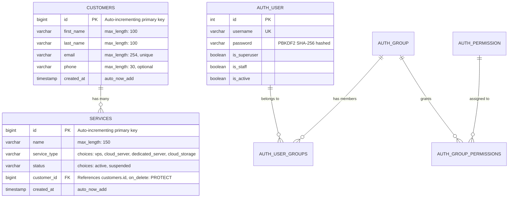

# Database Design & PostgreSQL Schema Specifications

This document outlines the data model, entity relationships, integrity constraints, and persistence strategy for the Cloud Management Platform.

---

## 1. Database Architecture & Single-Owner Policy

The PostgreSQL database is named `cloud_management_db`. 

**The Single-Owner Rule:**
Django (`backend/`) is the **sole and exclusive manager** of database migrations and schema definitions. Auxiliary microservices (`go-service` and `php-service`) NEVER connect to PostgreSQL directly; they interact with database records strictly through authenticated HTTP REST APIs provided by Django.

---

## 2. Entity-Relationship Diagram (ERD)



---

## 3. Schema & Integrity Specifications

### 3.1 Customer Model (`apps.customers.models.Customer`)
- **Table Name**: `customers_customer`
- **Fields**:
  - `id`: `BigAutoField` (Primary Key).
  - `first_name`: `CharField(max_length=100)`.
  - `last_name`: `CharField(max_length=100)`.
  - `email`: `EmailField(max_length=254, unique=True, db_index=True)`.
  - `phone`: `CharField(max_length=30, blank=True, null=True)`.
  - `created_at`: `DateTimeField(auto_now_add=True)`.
- **Ordering**: `['-created_at']` (latest first).

### 3.2 Service Model (`apps.services.models.Service`)
- **Table Name**: `services_service`
- **Fields**:
  - `id`: `BigAutoField` (Primary Key).
  - `name`: `CharField(max_length=150)`.
  - `service_type`: `CharField(max_length=50, choices=ServiceType.choices, default='vps')`.
    - Supported types:
      - `vps`: Virtual Private Server
      - `cloud_server`: Cloud Server
      - `dedicated_server`: Dedicated Server
      - `cloud_storage`: Cloud Storage
  - `status`: `CharField(max_length=20, choices=ServiceStatus.choices, default='active')`.
    - Supported statuses: `active`, `suspended`.
  - `customer`: `ForeignKey('customers.Customer', on_delete=models.PROTECT, related_name='services')`.
  - `created_at`: `DateTimeField(auto_now_add=True)`.
- **Database Constraints**:
  - `service_status_valid_choices`: SQL Check Constraint validating that `status` is strictly `'active'` or `'suspended'`.
- **Referential Integrity**:
  - `on_delete=models.PROTECT`: A customer cannot be deleted if active or suspended services are associated with that account.

---

## 4. Docker Volume Persistence & Backup Procedures

### 4.1 Persistence Mechanics
PostgreSQL data is stored inside the named Docker volume `cmp_postgres_data`, mounted to `/var/lib/postgresql/data`.
- Running `docker compose down` stops and removes containers while **safely preserving** `cmp_postgres_data`.
- Next startup via `docker compose up -d` immediately remounts the volume without data loss.

> **Caution**: Never run `docker compose down -v` unless you intentionally wish to permanently destroy all persistent database data.

### 4.2 Backup & Export Procedure (Safe SQL Dump)
To export a full database backup without downtime:
```bash
docker compose exec -T cmp_db pg_dump -U cloud_management_user -d cloud_management_db > backup_$(date +%Y%m%d_%H%M%S).sql
```

### 4.3 Database Restore Procedure
To restore a backup into a fresh database:
```bash
cat backup_file.sql | docker compose exec -T cmp_db psql -U cloud_management_user -d cloud_management_db
```
