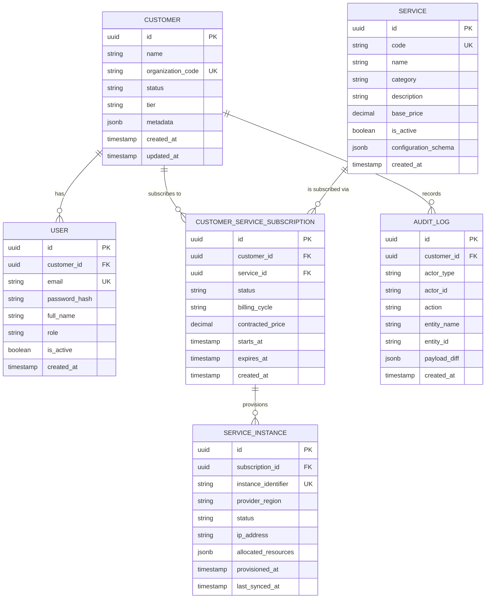

# Database Design & Domain Model Specification

## 1. Architectural Database Ownership

### The "Single Owner" Principle
The database architecture of the Cloud Management Platform (CMP) enforces a strict **Single Ownership Model**:

> **Rule of Ownership**:
> **Django (Core Backend)** is the sole, exclusive owner of the PostgreSQL database.
>
> 1. **Schema Authority**: All table definitions, foreign keys, indexes, triggers, and migrations are authored and executed exclusively through Django ORM migrations (`python manage.py migrate`).
> 2. **Access Control**: Only the Django application has database connection credentials configured to execute direct SQL queries (`SELECT`, `INSERT`, `UPDATE`, `DELETE`).
> 3. **Auxiliary Service Isolation**: The `go-service` and `php-service` do **not** possess direct PostgreSQL credentials or connection pools. When these services need to read or update customer or service records, they issue authenticated calls to Django's REST APIs.
> 4. **Benefits**:
>    - Eliminates race conditions and schema drift between heterogeneous language runtimes.
>    - Centralizes database validation, business rules, signals, and security checks in a single codebase.
>    - Prevents orphan records and guarantees relational integrity via Django's transactional ORM.

---

## 2. Entity Relationship Diagram (ERD)

---

## 3. Customer and Service Relationship Model

The relationship between **Customer** and **Service** is modeled as an enriched Many-to-Many association via `CustomerServiceSubscription` and provisioned `ServiceInstance` entities:

### 3.1 Customer (`customers_customer`)
Represents an organization or enterprise client utilizing the platform.
- **Attributes**:
  - `id`: UUID (Primary Key)
  - `name`: Organization name (e.g., "Acme Cloud Corp")
  - `organization_code`: Unique slug for tenancy isolation
  - `status`: Enum (`active`, `suspended`, `pending_verification`, `archived`)
  - `tier`: Service level tier (`starter`, `professional`, `enterprise`)
  - `created_at`, `updated_at`: Timestamps

### 3.2 Service Catalog (`services_service`)
Represents the catalog of cloud products provided by CMP (e.g., Virtual Compute, Object Storage, Managed Kubernetes, VPC Peering).
- **Attributes**:
  - `id`: UUID (Primary Key)
  - `code`: Unique identifier slug (e.g., `compute-vm-standard`, `storage-s3-tier1`)
  - `name`: Human-readable name
  - `category`: Service domain (`compute`, `storage`, `networking`, `database`)
  - `base_price`: Decimal base cost per billing unit
  - `configuration_schema`: JSONSchema defining custom parameters needed for provisioning
  - `is_active`: Boolean flag indicating if currently available for new orders

### 3.3 Customer Service Subscription (`services_subscription`)
Represents the binding agreement of a Customer subscribing to a Service.
- **Attributes**:
  - `id`: UUID (Primary Key)
  - `customer_id`: Foreign Key referencing `Customer`
  - `service_id`: Foreign Key referencing `Service`
  - `status`: Enum (`active`, `provisioning`, `deprovisioned`, `suspended`)
  - `billing_cycle`: Enum (`hourly`, `monthly`, `annual`)
  - `contracted_price`: Fixed or discounted rate agreed upon
  - `starts_at`, `expires_at`: Validity window

### 3.4 Service Instance (`services_instance`)
Represents the actual provisioned cloud resource allocated to a subscription.
- **Attributes**:
  - `id`: UUID (Primary Key)
  - `subscription_id`: Foreign Key referencing `CustomerServiceSubscription`
  - `instance_identifier`: External provider reference (e.g., cloud instance ID)
  - `provider_region`: Datacenter or region (e.g., `us-east-1`, `eu-central-1`)
  - `status`: Operational state (`running`, `stopped`, `terminated`, `error`)
  - `ip_address`: Assigned network interface IP
  - `allocated_resources`: JSONB storing CPU, RAM, disk specs
  - `last_synced_at`: Timestamp updated whenever `go-service` polls and pushes metrics

---

## 4. PostgreSQL Configuration Guidelines

1. **Host**: Configured via `DB_HOST` (default `localhost` during local development on macOS; `postgres` in Docker).
2. **Port**: Configured via `DB_PORT` (default `5432`).
3. **Primary Keys**: UUIDv4 (`UUIDField`) is recommended across all tables for enhanced security, distributed generation, and preventing ID enumeration.
4. **Connection Pooling**: Managed via Django's `DB_CONNECTION_MAX_AGE` (set to 600 seconds) or external PgBouncer in production.
5. **Auditing**: Every mutation triggers an `AuditLog` record to maintain traceability for customer actions and background worker sync operations.
