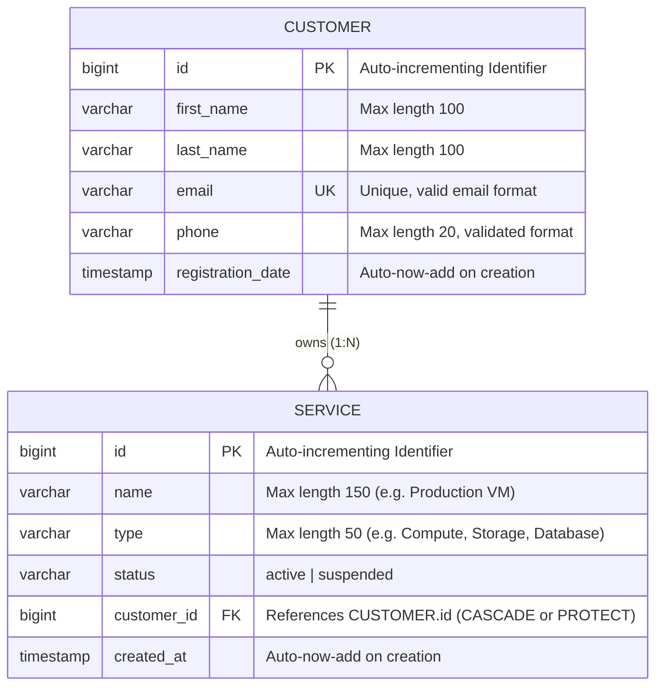

# Database Design & Data Model Specification

## 1. Architectural Database Ownership

### The "Single Owner" Principle
The database architecture of the Cloud Management Platform (CMP) enforces a strict **Single Ownership Model**:

> **Rule of Ownership**:
> **Django (Core Backend)** is the sole and exclusive owner of the PostgreSQL database.
>
> 1. **Schema Authority**: All table definitions, foreign keys, indexes, and migrations are authored and executed exclusively through Django ORM (`python manage.py makemigrations` and `python manage.py migrate`).
> 2. **Direct Connection Exclusivity**: Only the Django application has database credentials and establishes direct SQL connections to PostgreSQL.
> 3. **Auxiliary Service Isolation**: Neither `go-service` nor `php-service` connects directly to PostgreSQL. They interact with customer and service data exclusively through Django's HTTP REST APIs.
> 4. **No Schema Duplication**: Go and PHP do not maintain local database models or migrations for core entities.

---

## 2. Entity Relationship Diagram (ERD)

The domain model is intentionally focused on the core requirements of the platform:

---

## 3. Detailed Data Models

### 3.1 Customer Entity (`customers_customer`)
Represents an individual client or account in the platform.

| Field Name | Type | Constraints / Rules | Description |
| :--- | :--- | :--- | :--- |
| `id` | `BigAutoField` | Primary Key, Auto-increment | Unique identifier for the customer |
| `first_name` | `CharField(max_length=100)` | Required, Not Null | Customer's first name |
| `last_name` | `CharField(max_length=100)` | Required, Not Null | Customer's last name |
| `email` | `EmailField(unique=True)` | Required, Unique, Indexed | Customer's email address |
| `phone` | `CharField(max_length=20)` | Required, Valid phone format | Customer's contact phone number |
| `registration_date` | `DateTimeField` | `auto_now_add=True` | Timestamp when the customer was registered |

### 3.2 Service Entity (`services_service`)
Represents a cloud service provisioned for a specific customer.

| Field Name | Type | Constraints / Rules | Description |
| :--- | :--- | :--- | :--- |
| `id` | `BigAutoField` | Primary Key, Auto-increment | Unique identifier for the service |
| `name` | `CharField(max_length=150)` | Required, Not Null | Name of the service instance |
| `type` | `CharField(max_length=50)` | Required, Choices / Validated | Category or type (e.g., `Compute`, `Storage`) |
| `status` | `CharField(max_length=20)` | Choices: `active`, `suspended` | Current operational state (default: `active`) |
| `customer_id` | `ForeignKey(Customer)` | `on_delete=models.CASCADE` | Foreign Key referencing owning customer |
| `created_at` | `DateTimeField` | `auto_now_add=True` | Timestamp when the service was created |

---

## 4. Relationship Definition

- **Cardinality**: `Customer 1 ---- N Service`
- **Semantics**:
  - Each `Customer` can own zero, one, or multiple `Service` instances.
  - Every `Service` strictly belongs to exactly one `Customer` via the `customer_id` foreign key.
  - Deleting a customer cascades or safely protects their associated services depending on business rules.

---

## 5. Excluded Features (Out of Scope for MVP)

To keep the project clean, testable, and defensible in technical evaluation, the following enterprise elements are intentionally excluded:
- `CustomerServiceSubscription` (replaced by direct 1:N relationship)
- `ServiceInstance` (unified directly into `Service`)
- Billing & Invoicing engines
- Standalone Service Catalog registry
- Multi-tenant Organization hierarchies
- System-wide Audit Log tables
- Payment gateway integrations
- Cloud Provider Provisioning drivers

---

## 6. Database Operations & Idempotency Rules

1. **Local Development (macOS)**:
   - Initial development connects to PostgreSQL installed on macOS (`localhost:5432`).
   - Connection credentials are fully externalized in `backend/.env`.
2. **Idempotent Database Creation**:
   - Database initialization scripts must check for database existence (`SELECT 1 FROM pg_database WHERE datname = 'cmp_core_db'`).
   - If the database exists, scripts **must not** attempt re-creation or deletion.
3. **Data Preservation**:
   - **No script or command may drop, wipe, or truncate existing data** during local runs or Docker migrations.
4. **Docker Migration (Phase 7)**:
   - In Phase 7, PostgreSQL will be packaged in `docker-compose.yml` with named volumes (`postgres_data`) to guarantee data persistence.
